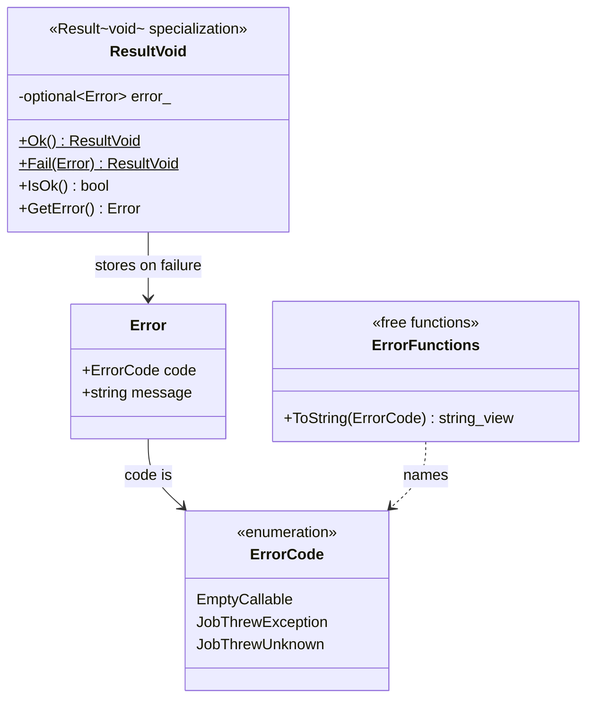

# Result and error type

## Class diagram



## Error codes

- **EmptyCallable**: a job was submitted with no work. Raised by `SubmitJob` before a job is created.
- **JobThrewException**: the work threw a `std::exception`. The message is its `what()` text.
- **JobThrewUnknown**: the work threw something that isn't a `std::exception`. The message is a fixed fallback.

## Files

```
include/taskscheduler/ErrorCode.h        enum class ErrorCode
include/taskscheduler/Error.h            struct Error
include/taskscheduler/ErrorFunctions.h   ToString declaration
include/taskscheduler/Result.h           Result<void> specialization
src/ErrorFunctions.cpp                   ToString definition
src/Result.cpp                           Result<void> definitions
```

## Tests

```
tests/ErrorTest.cpp
tests/ResultTest.cpp
```